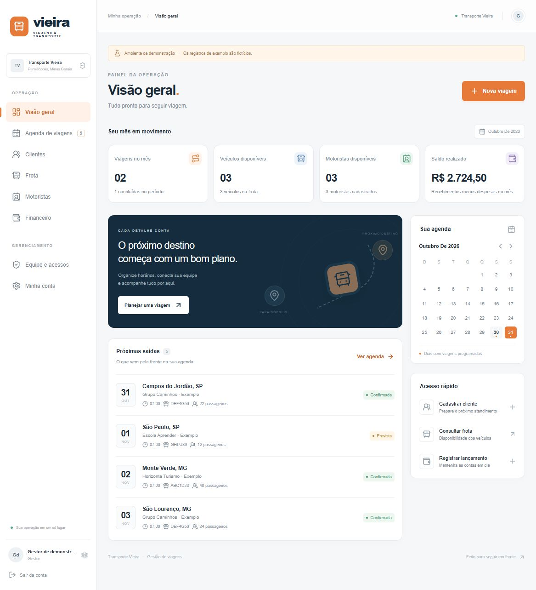

# Vieira Viagens

Aplicativo de gestão de viagens da Transporte Vieira, desenvolvido para o projeto de extensão de Murillo Danton Pereira Vieira, Engenharia de Software, Unopar.

## Conheça o projeto

O Vieira Viagens reúne agenda de viagens, cadastros de clientes, veículos e motoristas e controle financeiro básico. A primeira versão foi validada em testes locais com um sócio da empresa, que realizou cadastros e avaliou a facilidade de uso. A adoção na rotina da empresa está prevista de forma gradual, considerando a adaptação e a migração dos controles existentes.

Este repositório permite consultar o código, os testes e as instruções para executar o aplicativo. A aplicação ainda não está hospedada para acesso público pela internet.



A imagem e a carga de demonstração utilizam dados fictícios. Bancos de dados locais, credenciais, arquivos de ambiente e relatórios acadêmicos individuais não fazem parte desta publicação.

## Executar

Requisito: **Node.js 24 LTS** e npm. No computador em que o projeto foi criado, o iniciador também consegue utilizar o Node 24 já fornecido pelo Codex, mesmo que o Node padrão seja mais antigo.

Na pasta `transporte-vieira`:

```powershell
npm install
npm run dev
```

Acesse **http://localhost:3000**. No primeiro acesso, crie sua conta de gestor. Não existe senha padrão nem cadastro público depois dessa etapa. Os dados ficam salvos em `data/vieira.sqlite`; fechar o navegador ou reiniciar o aplicativo não os apaga.

No Windows, depois da instalação das dependências, você também pode abrir o arquivo **Iniciar aplicativo.cmd** com dois cliques. Mantenha a janela aberta enquanto estiver usando o aplicativo.

O botão **Carregar demonstração**, na visão geral de uma operação vazia, adiciona dados fictícios para explorar as funcionalidades. Use uma base separada se quiser alternar entre demonstração e registros reais. A aplicação identifica a demonstração nas telas e preserva seus registros; não há botão que apague toda a base.

## Funcionalidades

- Configuração inicial, entrada, saída e troca de senha com Better Auth.
- Perfis de gestor e operador, verificados na API. Apenas gestores acessam financeiro, auditoria e criação de usuários, e podem excluir cadastros.
- Painel mensal, próximas saídas e calendário navegável.
- Cadastro, edição e busca de clientes, veículos e motoristas.
- Criação e edição de viagens com filtros de situação e período.
- Validação de retorno, capacidade e disponibilidade. Reservas confirmadas não podem se sobrepor por veículo **ou** motorista, considerando um intervalo mínimo de 30 minutos.
- Viagens previstas não reservam recursos; os conflitos são conferidos ao confirmar. Cancelar libera a reserva. Viagens em andamento podem ser concluídas; viagens concluídas preservam o histórico.
- Detecção de edição desatualizada da mesma viagem. A validação e a gravação usam uma transação de escrita no SQLite.
- Receitas e despesas em centavos inteiros, vinculadas a viagens, com situação prevista ou realizada. O saldo realizado considera apenas valores pagos/recebidos.
- Exportação CSV dos resultados filtrados de viagens e lançamentos, com proteção contra fórmulas em planilhas.
- Histórico das últimas 40 ações e cópia de segurança pela linha de comando.
- Interface em português, adaptada a celular, com formulários em diálogos acessíveis por teclado.

## Monorepo

```text
apps/web/             Next.js App Router, React, interface e API Node.js
packages/core/        Tipos, validações Zod, formatação e exportação
packages/database/    SQLite, transações, regras de negócio e testes
scripts/              Inicialização, testes HTTP e cópias de segurança
data/                 Banco e segredo local de autenticação (ignorado)
```

O Next.js reúne interface e API na mesma origem e no mesmo processo de aplicação. Isso evita manter dois servidores, configurar CORS ou duplicar contratos de dados. Os workspaces npm compartilham os pacotes locais. O SQLite nativo do Node dispensa instalação de servidor de banco e compilação de um driver nativo.

## Comandos

| Comando             | Finalidade                                                                    |
| ------------------- | ----------------------------------------------------------------------------- |
| `npm run dev`       | Desenvolvimento local, ligado a `127.0.0.1`                                   |
| `npm run typecheck` | Conferência de tipos                                                          |
| `npm test`          | Testes das regras, persistência e transações                                  |
| `npm run build`     | Compilação de produção                                                        |
| `npm start`         | Executa a compilação de produção localmente                                   |
| `npm run test:http` | Testa autenticação, API e permissões em uma base isolada; requer build prévio |
| `npm run backup`    | Cria cópia consistente do SQLite em `data/backups`                            |
| `npm run setup`     | Alternativa de criação do primeiro gestor pelo terminal                       |

No `setup` pelo terminal, uma senha inicial aleatória é exibida uma vez. Altere-a em **Minha conta**. Também é possível fornecer `ADMIN_NAME`, `ADMIN_EMAIL` e `ADMIN_PASSWORD` por variáveis de ambiente. Prefira o formulário do primeiro acesso para definir sua própria senha sem usar o terminal.

## Dados e cópias de segurança

O segredo de autenticação é gerado automaticamente em `data/auth.secret`. Ele deve permanecer privado e precisa ser preservado ao mover a instalação. O cadastro público fica desativado; o gestor adiciona as pessoas em **Equipe e acessos**. Cada colaborador pode trocar sua senha em **Minha conta**.

Para criar uma cópia consistente, inclusive com a aplicação em uso:

```powershell
npm run backup
```

Para restaurar, pare a aplicação, preserve uma cópia da instalação atual e copie o arquivo de backup para **um novo caminho**, por exemplo `data/restaurado.sqlite`. Configure `DATABASE_PATH` com o caminho absoluto desse arquivo antes de reiniciar. Não sobrescreva um banco aberto nem misture os arquivos `-wal` e `-shm` de bases diferentes. Preserve o segredo de autenticação da instalação correspondente. O comando de backup copia o banco, não o arquivo de segredo; mantenha ambos em local protegido.

Variáveis opcionais estão em `.env.example`. A aplicação lê `apps/web/.env.local`; os comandos de terminal recebem as variáveis do ambiente do processo. Para usar um caminho de banco personalizado nos comandos de backup ou setup, defina a mesma variável no terminal. O horário das viagens é apresentado em **America/Sao_Paulo**.

## Escopo desta versão

Esta é uma primeira versão funcional para desenvolvimento local e piloto supervisionado. Não inclui GPS, emissão fiscal, processamento de pagamentos, otimização de rotas, recuperação de senha por e-mail nem aplicativo publicado em lojas. Os indicadores financeiros representam os lançamentos registrados, não um demonstrativo contábil.

Para disponibilizar à equipe pela internet, a etapa seguinte é configurar domínio, HTTPS, endereço de autenticação, backups externos e hospedagem com disco persistente. A configuração atual usa SQLite em um servidor; não deve ser implantada em hospedagem com disco temporário ou em várias réplicas com arquivos independentes. A estrutura dos pacotes permite substituir a persistência por um banco compartilhado quando necessário.

## Referências técnicas

- [Next.js App Router](https://nextjs.org/docs/app)
- [React](https://react.dev/)
- [SQLite do Node.js](https://nodejs.org/api/sqlite.html)
- [Better Auth com SQLite](https://better-auth.com/docs/adapters/sqlite)
- [Workspaces npm](https://docs.npmjs.com/cli/using-npm/workspaces)
